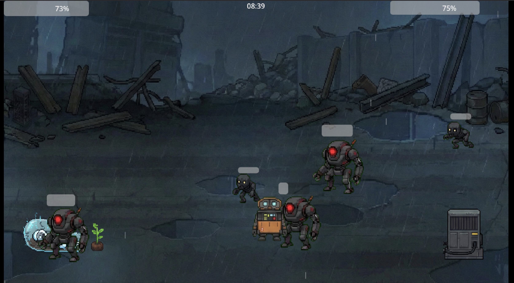

# The Last Charge

Made by a team of 3 in a 48-hour university game jam, where it won 1st place. It was my first project in Godot and GDScript. I worked on gameplay programming and level design.

A 2D survival shooter made with Godot 4.6. Keep one small robot and the last living plant on Earth alive for ten minutes, on a battery that drains with every shot you fire.

Mid-game combat. Aria's charge is at the top left, Unit-7's is at the top right, and the countdown is in the center.

**Play it on itch.io:** [https://saarhurvitz.itch.io/the-last-charge](https://saarhurvitz.itch.io/the-last-charge)

## The story

Humanity has left Earth, and only ruins and robots remain. A small robot named Unit-7 finds the last plant, dying beside Aria, an android lying in a pod. With hostile machines closing in, Unit-7 tethers itself to the pod and sets out to save the future.

## How to play

Survive until the 10:00 countdown reaches zero. The run ends if either Unit-7 or Aria runs out of charge.

Your health and your ammo are the same thing, so every shot is a trade:

- **Unit-7 drains constantly**, and each shot costs extra charge.
- **Aria drains constantly too**, and only Unit-7 can recharge her by standing next to her pod.
- **The battery charger** on the far side of the map from Aria is the only way to refill Unit-7.
- **Enemies pick a target when they spawn**, either Unit-7 or Aria, so you can't guard just one side.

### Controls

| Action | Keyboard and mouse | Gamepad |
| --- | --- | --- |
| Move | `WASD` or arrow keys | Left stick or D-pad |
| Aim | Mouse | Mouse |
| Light shot | Left mouse button | `X` or right trigger |
| Heavy shot | Right mouse button | `A` |
| Pause | `Esc` | `Back` |
| Restart | `R` | `Y` |

Gamepad buttons use Xbox names. Aiming always follows the mouse cursor.

## Game details

### Weapons

| | Charge cost | Damage | Cooldown |
| --- | --- | --- | --- |
| Light shot | 1 | 20 | 0.16 s |
| Heavy shot | 10 | 50 | 0.25 s |

### Enemies

| | Health | Speed | First appears |
| --- | --- | --- | --- |
| Small robot | 100 | 100 | 10:00 |
| Large robot | 220 | 100 | 09:00 |

### Charge

Unit-7 and Aria each start with 400 charge.

| | Passive drain | Enemy contact | Recharge |
| --- | --- | --- | --- |
| Unit-7 | 2 every 0.3 s | 10 on touch, then 10 about every second | 4 every 0.1 s at the battery |
| Aria | 2 every 0.5 s, rising to 3 at 04:10 | 5 every 0.5 s per enemy | 25 every 0.5 s while Unit-7 is at the pod |

### How a run escalates

Times are shown as they appear on the countdown.

| Countdown | What changes |
| --- | --- |
| 10:00 | Small robots spawn from the right every 3 s |
| 09:30 | Right-side spawns speed up to every 2.5 s |
| 09:00 | Rain begins and large robots join from the right |
| 08:00 | A second wave opens from the left, every 7 s |
| 07:20 | Large robots also come from the left, and right-side spawns ease to every 3.4 s |
| 05:00 | Left-side spawns speed up to every 5.6 s |
| 04:10 | Aria starts draining faster |
| 00:00 | You win |

## Running the project

1. Install [Godot 4.6](https://godotengine.org/download) or a later 4.x release.
2. Clone or download this repository.
3. In the Godot Project Manager, choose **Import** and select `project.godot`.
4. Press `F5` to run the game from the start menu.

Export presets for Windows and macOS are included in `export_presets.cfg`. To build the game, install the Godot export templates and use **Project > Export**.

## Project layout

| Path | Purpose |
| --- | --- |
| `scenes/main/start_menu.tscn` | Start menu and intro story, the game's entry point |
| `scenes/main/game_level.tscn` | Main level, including the HUD, spawners and end screens |
| `scripts/characters/player.gd` | Unit-7 movement, shooting and charge |
| `scripts/characters/aria.gd` | Aria's charge and pod logic |
| `scripts/enemies/small_robot_ai.gd`, `scripts/enemies/large_robot_ai.gd` | Small and large robot behavior |
| `scripts/enemies/enemy_spawner_right.gd`, `scripts/enemies/enemy_spawner_left.gd` | Right and left spawn schedules |
| `scripts/projectiles/light_shot.gd`, `scripts/projectiles/heavy_shot.gd` | Light and heavy projectiles |
| `scripts/world/battery_charger.gd` | Battery charger |
| `scripts/ui/hud.gd` | Countdown, rain trigger and win condition |
| `scripts/ui/` | Start, pause, game over and win screens |
| `assets/` | Sprites, UI art, backgrounds, tiles, icons, music and sound effects |
| `scenes/unused/`, `scripts/unused/` | Earlier prototypes that the game no longer loads |

Built with [Godot Engine](https://godotengine.org/) and GDScript.

## Disclaimer

The Last Charge is an unofficial, free, non-commercial fan game. It is not affiliated with, endorsed by, or sponsored by Disney or Pixar. WALL·E and related characters and trademarks belong to their respective owners.

Much of the game's art, including the story images, menu background and character sprites, was generated with Google Gemini. The music was also created with SUNO.AI.
